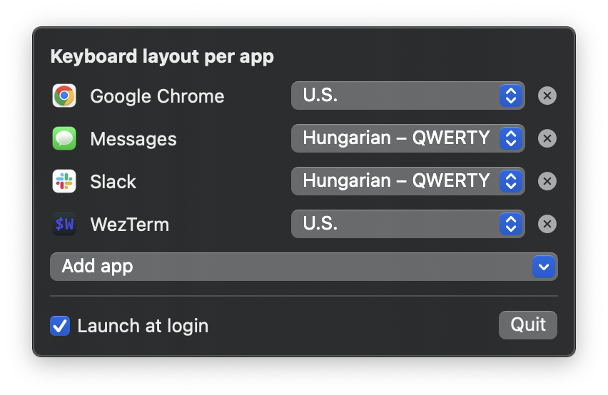

<p align="center">
  
</p>

<h1 align="center">AppLangswitcher</h1>

<p align="center">
  <a href="https://github.com/ducktordanny/applangswitcher/actions/workflows/build.yml"></a>
</p>

<p align="center">
  <b>Tired of switching keyboard layouts every time you switch apps?</b><br>
  Let your Mac do it for you.
</p>

<p align="center">
  
</p>

You chat in one language and code in another. Every ⌘Tab means another ⌃Space.
Every time you forget, you get `ő` or `ü` where a `[` should be.

**AppLangswitcher remembers which layout each app needs and switches to it the moment you focus that app.**
Set it once. Forget it exists.

## Why you'll like it

- **Instant**: the layout is ready before your first keystroke
- **Invisible**: lives in the menu bar, with no Dock icon and no windows
- **Set and forget**: rules survive restarts, and launch at login is one checkbox
- **No permissions**: no Accessibility or Input Monitoring access needed
- **Tiny and native**: pure Swift, zero dependencies
- **Your layouts**: works with every input source you have enabled

## Get it

```sh
git clone https://github.com/ducktordanny/applangswitcher.git
cd applangswitcher
make install
```

Needs macOS 13+ and Swift 6+. The Xcode Command Line Tools are enough.

## Use it

1. Click the keyboard icon in the menu bar.
2. **Add app**: pick a running app, or choose one from Applications.
3. Pick its layout.

That's it. Apps without a rule keep whatever layout you're on.

## Good to know

- Only layouts enabled in System Settings → Keyboard → Input Sources show up.
- If the layout flips back after switching, turn off *Automatically switch to a document's input source* in the same place.

## Development

| Command | What it does |
| --- | --- |
| `make run` | Build into `build/` and relaunch |
| `make icon` | Regenerate the app icon from `scripts/make-icon.swift` |
| `make clean` | Remove build output |

## License

[MIT](LICENSE)
